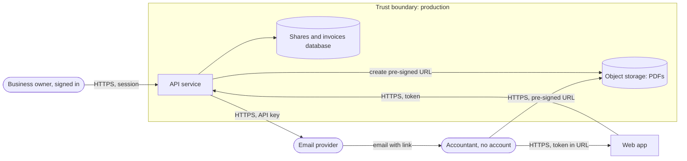

# Kata: threat model a feature

Threat model one small feature with STRIDE in 40 minutes. "Share an invoice with your accountant by link" sounds harmless, and that is why it is a good exercise: it crosses four trust boundaries, sends a secret through email, and opens a door to people who never log in. Find the threats, decide what to do about each, then compare with the model answer.

| | |
|---|---|
| Who | One engineer, a pair, or the team that will build the feature |
| Time | 45 minutes: 30 to model, 15 to compare |
| Practice it teaches | [Secure development](../../playbook/security/secure-development.md), [threat model template](../../templates/docs/threat-model.md), [access control](../../playbook/security/access-control.md), [data security and privacy](../../playbook/data/data-security-and-privacy.md) |

## The feature

A SaaS accounting product for small businesses wants to let an owner share invoices with their outside accountant, who has no account in the product. All organisations and numbers here are fictional.

1. The owner opens an invoice and clicks **Share with accountant**, entering the accountant's email address.
2. The API creates a share record with a random token and a 7-day expiry, then asks a third-party email provider to send the accountant a link: `https://app.example.com/s/<token>`.
3. The accountant clicks the link. The web app sends the token to the API.
4. The API looks up the share, checks it has not expired or been revoked, and returns a pre-signed object storage URL for the invoice PDF.
5. The browser downloads the PDF directly from object storage.
6. The owner can revoke any share from a list.

Invoices contain the customer's name, address, tax number, line items and bank details.

## Your task

1. List the assets an attacker would want.
2. Walk every element and every flow that crosses a trust boundary. For each, ask the six STRIDE questions from the [threat model template](../../templates/docs/threat-model.md#2-what-can-go-wrong-stride): spoofing, tampering, repudiation, information disclosure, denial of service, elevation of privilege.
3. Write at least 8 threats in a table: ID, element or flow, STRIDE letter, threat, likelihood, impact.
4. For each, choose a response (mitigate, eliminate, transfer, accept) and a control.
5. Answer: what is the one design change that removes the most risk?

Model answer: assets

| Asset | Why an attacker wants it |
|---|---|
| Invoice PDFs | Personal data, bank details and tax numbers of the business's customers; useful for fraud and invoice redirection scams |
| Share tokens | Each one is a key to an invoice without a password |
| Pre-signed URLs | Direct access to a PDF in storage, bypassing the API |
| Email provider API key | Lets an attacker send email that looks like it comes from the product |
| The share feature itself | A way to send email from a trusted domain to any address |

Model answer: threats and controls

| ID | Element or flow | STRIDE | Threat | L | I | Response and control |
|---|---|---|---|---|---|---|
| T1 | Token in URL | S | Attacker guesses or enumerates tokens | L | H | Mitigate: at least 128 bits from a secure random generator; rate limit and alert on failed lookups per IP |
| T2 | Shares database | I | Database read (backup leak, SQL injection) exposes every live token | M | H | Mitigate: store only a hash of the token, as with passwords; the raw token exists only in the email |
| T3 | Link in email and browser | I | Link forwarded, left in a shared mailbox, or leaked via browser history, proxy logs or the `Referer` header | H | H | Mitigate: 7-day expiry; revoke; `Referrer-Policy: no-referrer` on the share page; never log full tokens; optional one-time code sent to the accountant's email before download |
| T4 | Share creation | E | A user who may not view an invoice shares it anyway, so the token grants more than the user has | M | H | Mitigate: check the user's permission on the invoice when creating the share, in code, not in the UI |
| T5 | Token lookup | E | A token for one invoice is accepted for another (the API trusts an invoice ID sent alongside the token) | M | H | Eliminate: the token is the only input; the share record decides which invoice, and nothing from the client overrides it |
| T6 | Pre-signed URL | I | URL copied and reused long after the share expired | M | M | Mitigate: valid for 5 minutes, for one object, read-only |
| T7 | Share creation to email provider | D, S | Attacker with a free account sends thousands of share emails to arbitrary addresses: spam and phishing from your domain | H | M | Mitigate: rate limit shares per account and per day; fixed email template with no free text from the user; SPF, DKIM and DMARC on the sending domain |
| T8 | Email provider | I | Supplier sees and stores invoice data | M | M | Mitigate: email contains only the link and the business name, never amounts or attachments; supplier reviewed under [third-party and SaaS risk](../../playbook/security/third-party-and-saas-risk.md) |
| T9 | Email provider API key | S | Key stolen from code or CI and used to send convincing phishing | L | H | Mitigate: key in a secrets manager, scoped to send only, rotated ([secrets](../../playbook/security/secrets.md)) |
| T10 | Share create, revoke and access | R | Owner says "I never shared that"; no way to show who opened what | M | M | Mitigate: audit log of create, revoke and each access with time, user, IP and user agent, kept for the audit period |
| T11 | Object storage | T | PDF replaced in storage, for example with altered bank details | L | H | Mitigate: only the API's identity can write; object versioning; store a hash of each PDF and check it on generation |
| T12 | Share page | I | Email security scanners open the link automatically and record the token, or trigger "first open" logic | M | L | Accept with control: do not rely on one-time links; show a click-through page before the download |
| T13 | Share page | D | Many requests for large invoice sets slow the API | L | M | Mitigate: per-token and per-IP rate limits; large downloads generated as background jobs |

Scoring: 8 or more threats with sensible controls is a good result. Most people find T1, T3 and T6. Fewer find T2, T4, T5 and T7, which are the ones attackers use most.

Model answer: the one design change

Give the accountant an identity. Replace "anyone with the link" with an invitation that requires the accountant to verify their email with a one-time code (or sign in) before the first download, and bind the share to that verified address. This turns a bearer secret that can be forwarded into access for a named person, which removes most of T3, makes T10 meaningful and narrows T1. The cost is one extra step for the accountant. Record the choice in a [decision record](../../playbook/architecture/decision-records.md), because it trades convenience for security in a way the product owner must agree to.

## Going further

- Add an AI feature: "summarise this invoice for the accountant". Complete section 6 of the template and see which OWASP Top 10 for LLM Applications risks appear ([AI application security](../../playbook/ai/ai-application-security.md)).
- Run the same kata on a feature your team shipped last month. Count the threats you would have found before it shipped.
