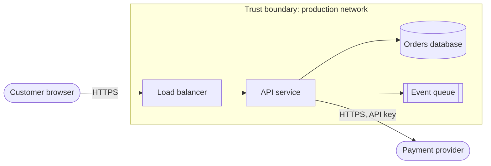

# Threat model: <system or feature name>

<!--
How to use: run this with the team in 1 to 2 hours at design time, before the first production
release, and update it when the design changes. It follows the four questions of the Threat
Modeling Manifesto and uses STRIDE to find threats. For AI features, also complete section 6.
Guidance: playbook/security/secure-development.md and playbook/ai/ai-application-security.md
-->

| Field | Value |
|---|---|
| System | |
| Tier | Tier 1 / Tier 2 / Tier 3 |
| Data classes handled | Public / Internal / Confidential / Restricted |
| Participants | |
| Date | YYYY-MM-DD |
| Next review | YYYY-MM-DD, or on design change |
| Related design doc or ADR | |

## 1. What are we working on?

### Scope

What is in scope and what is not.

### Diagram

Draw the data flow: external actors, processes, data stores, data flows, and trust boundaries (where the level of trust changes, such as internet to load balancer, service to database, your system to a supplier). Mermaid example:

### Assets

| Asset | Class | Why an attacker wants it |
|---|---|---|
| | | |

### Entry points and trust boundaries

| Entry point | Who can reach it | Authentication |
|---|---|---|
| | | |

## 2. What can go wrong? (STRIDE)

Walk each element and each flow that crosses a trust boundary. For each STRIDE category, ask the question.

| Category | Property broken | Question to ask |
|---|---|---|
| **S**poofing | Authentication | Can someone pretend to be a user, service or system? |
| **T**ampering | Integrity | Can someone change data, code or configuration in transit or at rest? |
| **R**epudiation | Non-repudiation | Can someone deny an action because we cannot prove it? |
| **I**nformation disclosure | Confidentiality | Can someone read data they should not? |
| **D**enial of service | Availability | Can someone stop or degrade the service, or run up its cost? |
| **E**levation of privilege | Authorisation | Can someone gain rights they should not have? |

### Threats found

| ID | Element or flow | STRIDE | Threat | Likelihood (L/M/H) | Impact (L/M/H) |
|---|---|---|---|---|---|
| T1 | API to database | I | SQL injection exposes order data | M | H |
| T2 | | | | | |

## 3. What are we going to do about it?

| Threat ID | Response (Mitigate / Eliminate / Transfer / Accept) | Control | Owner | Ticket | Due |
|---|---|---|---|---|---|
| T1 | Mitigate | Parameterised queries; SAST rule blocks merge; least-privilege DB user | | | |
| T2 | | | | | |

Accepted risks need a named owner and an expiry date, and go in the risk register.

## 4. Did we do a good enough job?

- [ ] Every flow that crosses a trust boundary was walked against all six STRIDE categories.
- [ ] Every high-impact threat has a control or a recorded acceptance.
- [ ] Controls are tracked as tickets with owners.
- [ ] Someone outside the team (security champion or security team) reviewed this model.
- [ ] Tests or monitoring exist that would show if a key control stopped working.

## 5. Supply chain and operations

| Question | Answer |
|---|---|
| Third-party services and libraries that see sensitive data | |
| How are build artifacts signed and verified? | |
| Where are secrets stored, and who can read them? | |
| What is logged for security investigation, and for how long? | |

## 6. AI features (complete if the system uses a language model or agent)

| OWASP LLM 2025 risk | Applies? | Control |
|---|---|---|
| LLM01 Prompt Injection | | |
| LLM02 Sensitive Information Disclosure | | |
| LLM03 Supply Chain | | |
| LLM04 Data and Model Poisoning | | |
| LLM05 Improper Output Handling | | |
| LLM06 Excessive Agency | | |
| LLM07 System Prompt Leakage | | |
| LLM08 Vector and Embedding Weaknesses | | |
| LLM09 Misinformation | | |
| LLM10 Unbounded Consumption | | |

Tools the agent can call, the identity it uses, and which actions need human approval:

| Tool | Read or write | Identity and scope | Human approval required? |
|---|---|---|---|
| | | | |

## References

- Threat Modeling Manifesto: https://www.threatmodelingmanifesto.org/
- OWASP Threat Modeling Cheat Sheet: https://cheatsheetseries.owasp.org/cheatsheets/Threat_Modeling_Cheat_Sheet.html
- Microsoft, STRIDE threat categories: https://learn.microsoft.com/en-us/azure/security/develop/threat-modeling-tool-threats
- OWASP Top 10 for LLM Applications 2025: https://genai.owasp.org/resource/owasp-top-10-for-llm-applications-2025/
